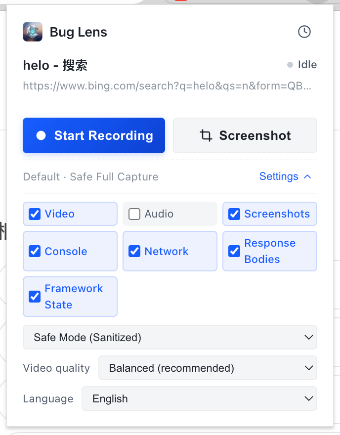
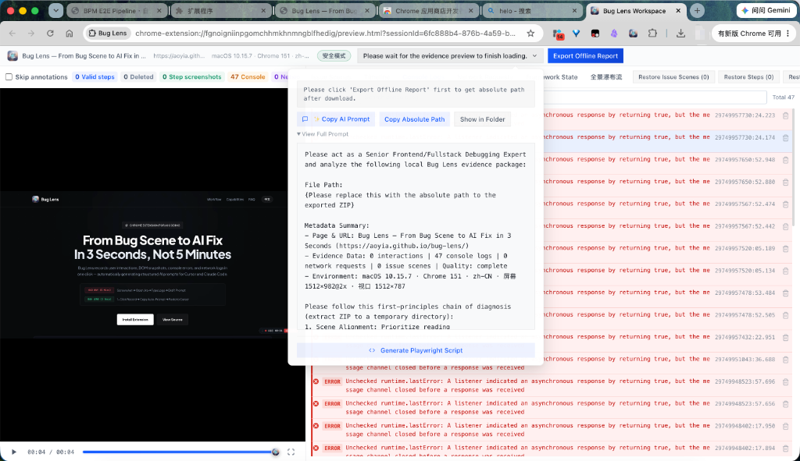
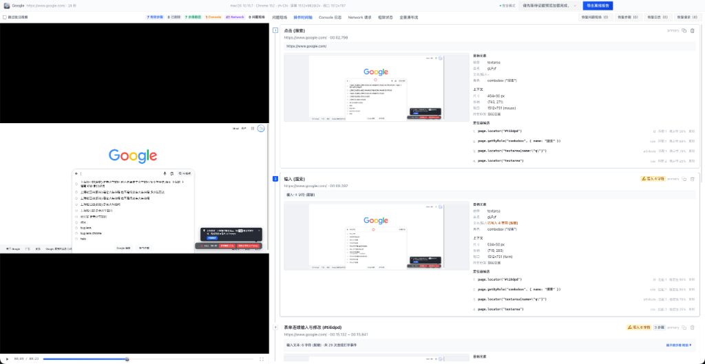
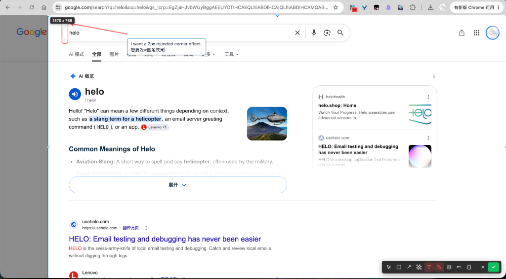

# Bug Lens

**English** | [中文文档](README_zh.md)

> **The Ultimate Context Provider for AI Code Assistants & Vibe Coders**  
> Effortlessly capture full-stack bug context from browser sessions—DOM snapshots, click tracks, console errors, and network payloads—and export structured AI prompts ready for instant diagnosis.

---

## ⚡ Highlights & Features

### 1. Full-Context Safe Recording Panel

One-click session recording with full control over DOM snapshots, console logs, network request/response bodies, and framework state, with built-in local data sanitization.



### 2. In-Page Compact Recording Widget

A lightweight floating widget docked during recording. Supports instant issue marking (`Alt/Option+S`), live timer display, and one-click silent export (`Stop & Export`).



### 3. Step-by-Step Action Capture & Visual Timeline (Click Highlights & Locators)

Automatically captures keyframe snapshots for each interaction with precise click indicators (red visual circles). Concurrently extracts target element context (tag, class, role, coordinates) and generates stability-scored Playwright locators, enabling AI assistants to reconstruct user actions and generate automated regression tests effortlessly.



### 4. Web Screenshot & AI Prompt Annotation

Standalone screenshot capture with pixel dimension measurement, directional arrows, and bilingual notes to formulate precise visual bug reports and design modification prompts for AI.



---

## 🚀 3-Step Quickstart

1. **Install Extension**: Download the pre-compiled [bug-lens-v0.7.38.zip](https://github.com/Aoyia/bug-lens/releases/latest), unzip, and load via **"Load unpacked"** in Chrome (`chrome://extensions/` with Developer Mode enabled).
2. **One-Click Record**: Click the extension icon (or press `Ctrl/Cmd+Shift+Y`) on any web page and reproduce the bug.
3. **Feed to AI**: Click **"Stop & Export"**—Bug Lens automatically downloads the offline ZIP archive and copies the optimized `AI_PROMPT.md` to your clipboard. Simply paste into Cursor, Claude Code, Codex, Antigravity, or other AI assistants to fix the bug instantly!

---

## 🤖 AI Agent Integration (MCP Server & Triage Skill)

Bug Lens ships with an official [`bug-lens-mcp`](packages/evidence-mcp/README.md) server and companion [`bug-lens-triage`](.agents/skills/bug-lens-triage/SKILL.md) Agent Skill, allowing AI assistants to inspect `.zip` evidence packs and CSS cascade snapshots directly in memory without manual extraction or ad-hoc parsing scripts.

### Option 1: Ask Your AI Agent to Install Automatically (Recommended)

Paste the following prompt (or this repo URL `https://github.com/Aoyia/bug-lens`) into Claude Code, Cursor, or Antigravity:

```text
Please install and configure the Bug Lens MCP Server and Triage Skill (npm package: bug-lens-mcp):
1. Run `npx -y bug-lens-mcp@latest install-skill` to install the `bug-lens-triage` skill into the global skills directory (~/.gemini/config/skills, ~/.claude/skills, or ~/.cursor/skills);
2. Register the MCP server named "bug-lens-evidence" with command "npx" and args ["-y", "bug-lens-mcp@latest"] in the active AI client MCP config (for Claude Code, run `claude mcp add bug-lens-evidence -- npx -y bug-lens-mcp@latest`).
```

### Option 2: Manual CLI & Config Setup (Requires Node.js >= 20)

1. **Install the `bug-lens-triage` Skill**:

```bash
# Auto-detect and install into global skills directories (Antigravity / Claude Code / Cursor)
npx -y bug-lens-mcp@latest install-skill

# Or install into the current project's .agents/skills/bug-lens-triage/SKILL.md
npx -y bug-lens-mcp@latest install-skill project
```

2. **Register the `bug-lens-evidence` MCP Server**:

- **Claude Code**:
  ```bash
  claude mcp add bug-lens-evidence -- npx -y bug-lens-mcp@latest
  ```
- **Google Antigravity** (`~/.gemini/config/mcp_config.json`) or **Cursor** (`~/.cursor/mcp.json`):
  ```json
  {
    "mcpServers": {
      "bug-lens-evidence": {
        "command": "npx",
        "args": ["-y", "bug-lens-mcp@latest"]
      }
    }
  }
  ```

---

## 📦 Build from Source

```bash
pnpm install
pnpm run build
# Package release ZIP
pnpm run package
```

## 💬 Community & Feedback

- **Discussions & Ideas**: Join our [GitHub Discussions](https://github.com/Aoyia/bug-lens/discussions) to share ideas, ask questions, or request features.
- **Bug Reports**: Open a [GitHub Issue](https://github.com/Aoyia/bug-lens/issues) with captured evidence.
- **WeChat Group**: Scan the QR code below (primarily for Chinese community):


> If the QR code expires, please open an [Issue](https://github.com/Aoyia/bug-lens/issues).

---

## 📄 License

This project is licensed under the [GNU Affero General Public License v3.0](LICENSE) (AGPL-3.0).
