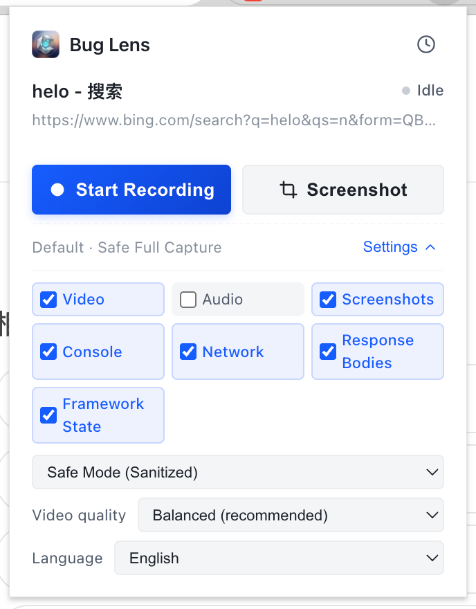
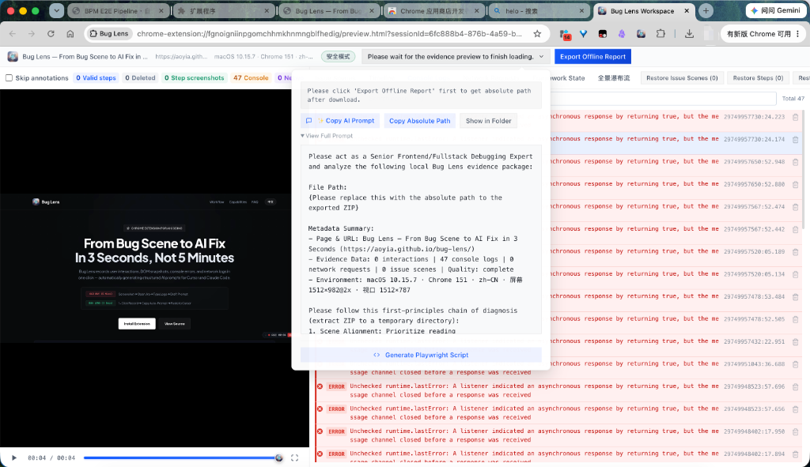
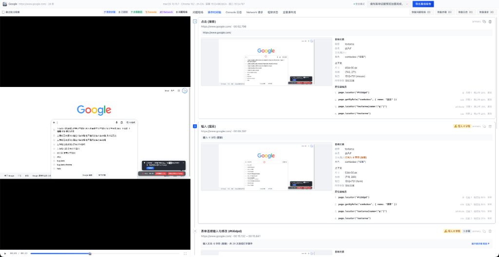
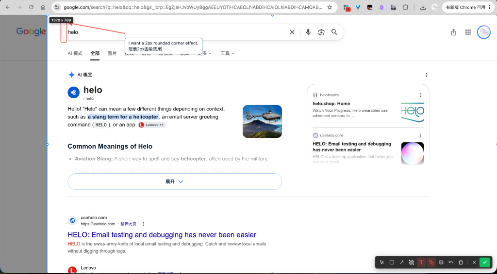

# Bug Lens

[English Version](README.md) | **中文文档**

> **AI 编程助手与 Vibe Coding 创作者的现场感知利器**  
> 一键捕获浏览器前端缺陷的完整运行时上下文（DOM 快照、点击轨迹红圈、Console 报错与网络报文），自动生成结构化 AI 提示词与离线证据包，让 AI 精准排障与修复。

---

## ⚡ 核心能力一览

### 1. 全量上下文配置与安全录制面板

一键开启录制，自由勾选视频、截图、控制台、网络请求/响应体以及前端框架状态，内置本地数据隐私脱敏模式。



### 2. 页面轻量吸附录制挂件

录制期间在网页边缘提供无干扰挂件，支持快捷标记缺陷现场（`Option+S` / `Alt+S`）、实时录制时长显示以及一键直出结束导出。



### 3. 操作步骤捕获与可视化时间轴（精准红圈 + 定位器推导）

录制过程中自动捕获每个交互的关键帧截图，并在点击位置绘制红圈标记；同步解析目标元素属性（Tag、Class、Role、坐标与尺寸），自动生成带稳定性评分的 Playwright 定位器代码，帮助 AI 零歧义还原操作路径并生成自动化复现脚本。



### 4. 网页即时截图与 AI 提示词批注

无需录制时的独立截图工具，支持区域框选裁剪、像素尺寸测量、划线箭头指向与中英双语文字批注，直接向 AI 精准描述前端缺陷与修改诉求。



---

## 🚀 3 步极速上手

1. **安装插件**：下载预编译安装包 [bug-lens-v0.7.38.zip](https://github.com/Aoyia/bug-lens/releases/latest) 并解压，在 Chrome 扩展管理页（`chrome://extensions/` 开启开发者模式）点击 **“加载已解压的扩展程序”**。
2. **一键录制**：在目标网页点击插件图标或按 `Cmd/Ctrl+Shift+Y` 开始录制并复现问题。
3. **丢给 AI**：点击 **“结束并导出”**，Bug Lens 自动下载离线证据包并将生成的 AI 提示词写入剪贴板，直接粘贴到 Cursor、Claude Code、Codex 或 Antigravity 等 AI 助手即可开启精准修复！

---

## 🤖 AI 助手深度接入（MCP Server & 诊断 Skill）

Bug Lens 提供官方 [`bug-lens-mcp`](packages/evidence-mcp/README_zh.md) 服务与配套的 [`bug-lens-triage`](.agents/skills/bug-lens-triage/SKILL.md) 诊断技能，支持 AI 助手在内存中免解压直读 `.zip` 证据包、按需检索 Console/Network/DOM/CSS 级联快照，彻底告别手动解压与临时解析脚本。

### 方式一：直接让 AI 帮你自动安装（推荐）

将以下指令（或本仓库地址 `https://github.com/Aoyia/bug-lens`）直接发送给你的 AI 编程助手（Claude Code / Cursor / Antigravity）：

```text
请帮我安装并配置 Bug Lens 的诊断 MCP Server 与配套 Skill（npm 包：bug-lens-mcp）：
1. 在终端执行 `npx -y bug-lens-mcp@latest install-skill`，将 bug-lens-triage 技能自动安装到全局技能目录（~/.gemini/config/skills、~/.claude/skills 或 ~/.cursor/skills）；
2. 在当前 AI 客户端的 MCP 配置文件中注册名为 "bug-lens-evidence" 的服务，command 为 "npx"，args 为 ["-y", "bug-lens-mcp@latest"]（若为 Claude Code 可直接执行 `claude mcp add bug-lens-evidence -- npx -y bug-lens-mcp@latest`）。
```

### 方式二：手动命令行与配置接入（要求 Node.js >= 20）

1. **一键安装 `bug-lens-triage` 诊断 Skill**：

```bash
# 自动识别并安装到全局技能目录（Antigravity / Claude Code / Cursor）
npx -y bug-lens-mcp@latest install-skill

# 或仅安装到当前业务工程的 .agents/skills/bug-lens-triage/SKILL.md
npx -y bug-lens-mcp@latest install-skill project
```

2. **注册 `bug-lens-evidence` MCP Server**：

- **Claude Code**：
  ```bash
  claude mcp add bug-lens-evidence -- npx -y bug-lens-mcp@latest
  ```
- **Google Antigravity**（`~/.gemini/config/mcp_config.json`）或 **Cursor**（`~/.cursor/mcp.json`）：
  ```json
  {
    "mcpServers": {
      "bug-lens-evidence": {
        "command": "npx",
        "args": ["-y", "bug-lens-mcp@latest"]
      }
    }
  }
  ```

---

## 📦 从源码构建

```bash
pnpm install
pnpm run build
# 打包生成发布 ZIP 包
pnpm run package
```

## 💬 交流群

扫码加入微信群（反馈 Bug、提需求、催更交流）：


> 二维码如过期，可在 [Issues](https://github.com/Aoyia/bug-lens/issues) 或 [Discussions](https://github.com/Aoyia/bug-lens/discussions) 留言更新。

---

## 📄 开源许可证

本项目采用 [GNU Affero General Public License v3.0 (AGPL-3.0)](LICENSE) 开源许可证。
