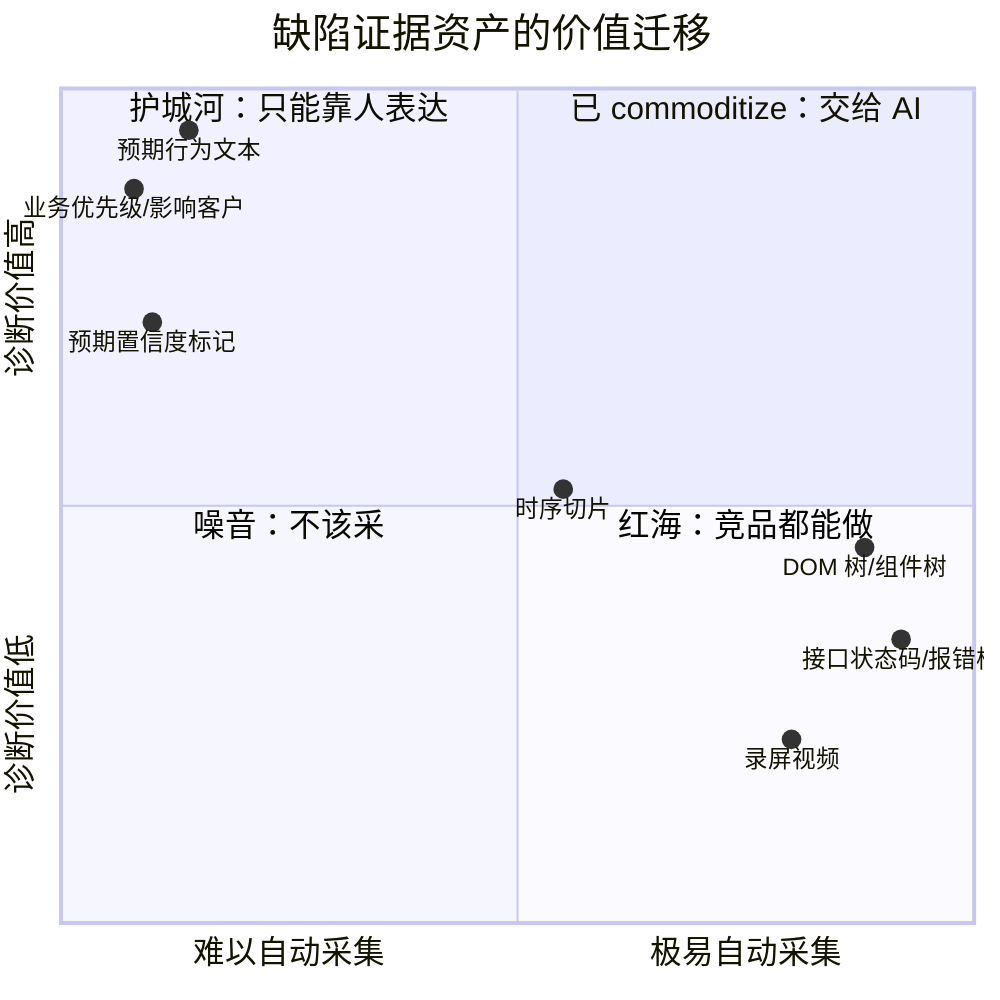
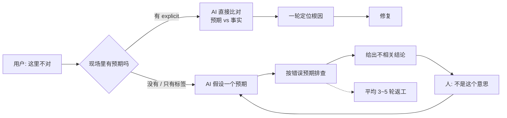
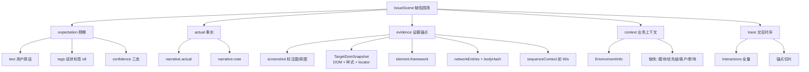
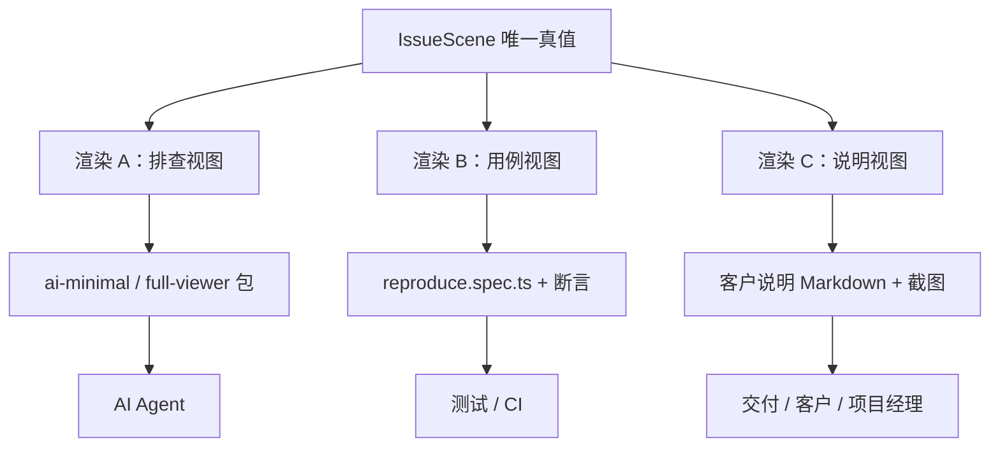
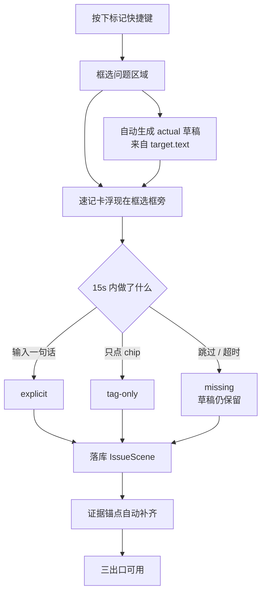
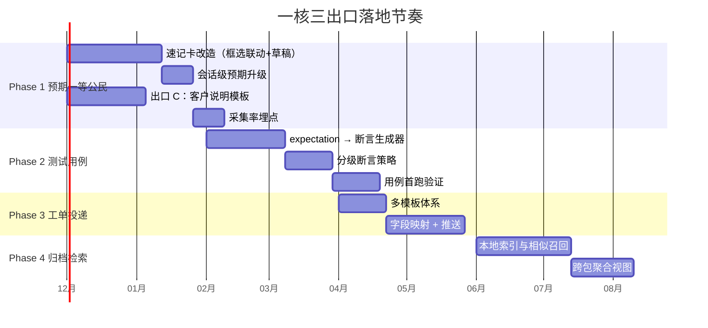

# 一核三出口：把缺陷现场做成结构化资产

> 产品方案。基准代码 `.worktrees/v5`（Schema v5），2026-11。前置阅读：`docs/产品第一性原理.md`（P1–P5）。

## 0. 一句话定位

**把一次缺陷现场沉淀成一个结构化对象 IssueScene，再按三种受众渲染三种产物：给 AI 排查、给测试复现、给客户说明。核心不是采更多数据，是把"只有人知道的东西"采下来。**

Bug Lens 的采集能力已超过多数用户的使用深度，继续加维度边际收益最低。缺的是用户脑子里那句"我本来以为点提交会跳转成功页"——没有传感器能采，只能被人表达，而现在表达太重。

## 1. 为什么是现在

### 1.1 机械事实正在贬值

"把现场抓全"曾经是核心竞争力，因为 AI 看不懂网页。这个前提正在失效：多模态模型能读截图判断布局、读 HAR 判断接口失败、对 DOM 做结构推理。**凡是"看一眼就能知道"的事实，价值都在归零。**

人的判断则在升值——AI 不知道这个字段该不该为空、这个按钮对这家客户是不是核心流程。这些不是数据，是**业务约定**，只存在于人脑与口头共识里。

| 资产类型     | 典型内容                                     | 获取方式       | 趋势                          |
| ------------ | -------------------------------------------- | -------------- | ----------------------------- |
| 机械事实     | 状态码、DOM、报错栈、截图、录屏、组件树      | 传感器采集     | 贬值：AI 自己能补，竞品已拉平 |
| 结构化事实   | 时序切片、CAS 请求正文、CSS winner rules     | 采集 + 加工    | 缓慢贬值：有工程价值，非壁垒  |
| 人的判断     | 预期行为、业务规则、优先级、影响谁、能否接受 | **只能被表达** | 升值：AI 越强，缺它越致命     |
| 判断的可信度 | 这句预期是用户说的，还是我们猜的             | 元数据设计     | 升值：决定 AI 该信谁          |



### 1.2 bug 的本质决定了缺口在哪

bug = **预期与事实的偏差**。只有事实、没有预期的证据包，等于只给了方程式的一边。AI 拿到它，唯一能做的是**自己假设一个预期**，再按这个假设找根因。



返工的根因不是 AI 笨，是**输入缺了一半**。补这一半，在"标记那一刻"是 5 秒，在"AI 问回来那一刻"是 5 分钟加一次上下文重建。

代码里已承认这点：`src/shared/protocol.ts:773-785` 的注释写明 confidence 区分"显式表达/仅症状标签/未捕获"，且**"禁止在缺失或仅标签时脑补为已知事实"**。设计者知道预期会缺、缺了会幻觉——只是产品把缺口**标注**出来了，没有系统性地**缩小**它。本方案做后者。

## 2. 核心洞察：价值本来就是人定的

有一类信息无论采集技术怎么进步都采不到，因为它不在页面上：业务正确性（金额保留几位是财务规则）、优先级（同样白屏，内部工具下周修、收银台现在修）、影响范围、可接受性。四者的共同点是**只能被表达，不能被采集**。

所以工具的正确姿势不是替人判断，而是把表达摩擦降到接近零（低到用户烦躁时愿意顺手说一句），并把表达结果固化进现场（和截图、DOM、时序绑在同一个对象上，而不是丢进某个备注）。

### 2.1 宁可降级，不能留空

`ExpectedStatement.confidence` 取值为 `"explicit" | "tag-only" | "missing"`（`src/shared/protocol.ts:784`）。三态而非两态，意味着产品承认"我知道我不知道"。

这条纪律在四处贯彻：`src/domain/issue-scene.ts:104-141` 的 `normalizeExpected`——旧版字符串一律降级为 `missing`，只有标签无文本一律降级为 `tag-only`；`src/domain/privacy-policy.ts:742` 的 `sanitizeExpectedStatement` 脱敏后仍保留语义；`src/triage-cli/pack/narrative.ts:19-62` 的 `resolveSceneExpectation` 在 `tag-only` 时注入 `TAG_ONLY_EXPECTATION`、`missing` 时注入 `UNCAPTURED_EXPECTATION`；`src/triage-cli/tools/get-scene.ts:225` 直接把警告渲染进给 AI 的 Markdown。

**判断：这是当前产品最被低估的资产。** 它把"信息可能不准"从隐含风险变成显式契约。竞品能做更漂亮的采集面板，但抄不走这套可信度分级——因为它不是功能，是产品性格。

## 3. 一核：IssueScene

IssueScene 是唯一真值，三个出口都是它的渲染，不是副本。



### 3.1 expectation

真实字段（`src/shared/protocol.ts:778-785`）：

| 字段         | 类型                                    | 说明                                             |
| ------------ | --------------------------------------- | ------------------------------------------------ |
| `text`       | `string`                                | 用户原话，可能为空串（仅标签形态）               |
| `tags`       | `string[]?`                             | 症状标签，归一化后上限 8（`issue-scene.ts:118`） |
| `confidence` | `"explicit" \| "tag-only" \| "missing"` | 可信度，**最关键**                               |

它挂在 `narrative` 下（`protocol.ts:847-851`），与 `actual`、`note` 同级。会话级还有降级的 `userNarrative.expected?: string`（`protocol.ts:273-277`），保留了"没有截图也能说一句"的通道——但它是裸字符串、无 confidence，**这是要还的技术债**。

### 3.2 actual 与 trace

`narrative.actual` 加 `note`。注意 actual 是**用户描述**的事实，不是采集的事实——采集的事实在 evidence 里，而"他觉得发生了什么"恰恰是判断偏差的核心材料。

trace 由 `interactions[]` 全量构成（kind 覆盖 click/input/change/submit/keydown/navigation/scroll/contextmenu/dblclick/file，`protocol.ts:441-451`），`sequenceContext` 是锚点附近的稠密切片。复现路径与 Playwright 脚本都从这里来。

### 3.3 evidence

现场携带的是**指针**，不是全量副本：`screenshot.status` 与 `originalAssetId`/`annotatedAssetId`（`protocol.ts:853-860`）；`target: TargetDomSnapshot`（`protocol.ts:738-755`）含 `sanitizedHtml`、`ancestors`（截断 5 层）、`computedStyle`（截断 20 项，`issue-scene.ts:191-202`）、`locators[]`（带 `matchCount` 与 `stabilityScore`）；`FrameworkSnapshot`（`protocol.ts:339-343`）的节点带 `componentFile`、`componentLine`——**从 UI 元素直连源码位置**的桥；网络经 `bodyHash` 指向 CAS blob；`sequenceContext`（`protocol.ts:821-826`）冻结前 60 秒、最多 30 条交互 + 30 条 console，并注明"禁止当作已证实的因果链"。

### 3.4 context：最薄的一环

| 需要的上下文                        | 现状                                                                 |
| ----------------------------------- | -------------------------------------------------------------------- |
| 环境（UA/平台/分辨率/视口/在线）    | 有，`EnvironmentInfo`（`protocol.ts:380-394`），会话级、自动、零摩擦 |
| 扩展版本 / Schema 版本              | 有                                                                   |
| 功能模块 / 影响范围 / 优先级 / 客户 | **全无**                                                             |

后四项在 `protocol.ts` 里零命中——不是遗漏，是产品还停在"工程师视角"。出口 C 一旦成立就必须补，因为交付写工单第一个填的就是"影响哪些客户、什么优先级"。**但不能做成必填表单**。

### 3.5 三条原则

1. **预期可降级**：`explicit → tag-only → missing` 单向，任何环节只能降不能升。已实现，必须守住。
2. **事实可指针化**：现场只存锚点与哈希，正文进 CAS。已实现。
3. **三出口同源真值**：禁止为某出口单独维护数据。工单里那句话必须能追溯到 `scene.narrative.expected.text`。`resolvePromptNarrative`（`evidence-package.ts:90-110`）已在做单点解析。

## 4. 三出口

同一份 IssueScene，三种渲染，受众不同，取舍完全不同。



### 4.1 出口 A：给 AI 排查（已有，方向是做薄）

- **受众**：排查 Agent，及把它当外脑的研发。
- **产物**：Schema v5 包（默认 `full-viewer`，开启 AI 精简模式为 `ai-minimal`）。构成见 `evidence-package.ts:1904-1960`：`README.md`、`AI_PROMPT.md`、`reproduce.spec.ts`、`session-data.json`、`network-details.json`、`network/blobs/*.bin`、`issues/<sceneId>/*`、`screenshots/*`。
- **关键字段**：`issueScenes[].scene.narrative`、`target.element.framework`、`locators[]`、`sequenceContext`、`networkEntries[].bodyHash`。
- **成功标准**：开包到可验证根因 ≤ 3 轮工具调用，不产生预期幻觉。

**做薄，不做厚。** AI 能自己从 `session-data.json` 生成任何视图，甚至自己看截图；继续塞东西边际价值接近零，成本却是 Token——`ai-evidence-pack-spec.md` 的审计已证明录屏占体积 46.1%、AI 消费率不足 10%，控制台 76%~97.5% 是噪音。

方向是"**锚点 + 指针**"：保留现场锚点、源码指针（`componentFile:componentLine`）、网络指针（`bodyHash`）、时序锚点；完整 DOM 与请求体下推为按需拉取；新增一句话 `sceneDigest`。不是删功能，是把入口从仓库改成索引。

### 4.2 出口 B：给测试（新）

- **受众**：测试工程师、CI 流水线。
- **产物**：可运行的 Playwright 用例 + 预期校验点断言。

测试要的从来不是工单，而是**一个 `npx playwright test` 就能红/绿的东西**。现状：`reproduce.spec.ts` 已在包里（`evidence-package.ts:1913-1923`），交互序列也被翻译成点击/输入/跳转，但断言是空的——`playwright-generator.ts:409-410` 只留一行 `// Add assertions here to verify the expected page state`。**出口 B 的全部缺口就是：有 trace，没 assertion。** 而 assertion 只能从 `expectation` 派生，所以"预期一等公民"是前置条件，顺序不能反。

```ts
// 由 IssueScene 生成，confidence: explicit
test("提交订单后应显示成功提示并跳转", async ({ page }) => {
  await page.goto("https://shop.example.com/cart");
  await page.getByRole("button", { name: "提交订单" }).click();
  // 断言来自 expectation.text，不是猜的
  await expect(page.getByText("下单成功")).toBeVisible();
  await expect(page).toHaveURL(/\/orders\/\d+/);
});
```

- **关键字段**：`interactions[].element.locators[0].expression`（定位）、`expectation.text`（断言语义）、`expectation.confidence`（断言强度）、`screenshot.annotatedAssetId`（失败视觉基线）。
- **成功标准**：现场到可执行用例 ≤ 1 次点击；`explicit` 场景首跑通过率 > 70%（不通过说明复现路径本身有问题，也是有效信号）。

置信度决定断言策略，这是最需要设计的地方：

| confidence | 断言策略                              | 用例标记                    |
| ---------- | ------------------------------------- | --------------------------- |
| `explicit` | 实质断言 `toBeVisible()/toHaveText()` | `@verified-intent`，可进 CI |
| `tag-only` | 软断言 `expect.soft` + TODO           | `@needs-assertion`，不阻塞  |
| `missing`  | 只复现步骤 + `test.fixme()`           | `@draft`，不进 CI           |

### 4.3 出口 C：给交付/客户（新）

- **受众**：交付实施、客户成功、项目经理，以及看工单的客户方接口人——他们不看 DOM 和 console。
- **产物**：可直接粘贴进飞书/企微/邮件/工单系统的 Markdown，配 1~2 张截图。

现状有雏形：`buildTicketTemplate`（`evidence-package.ts:750-900`）产出固定模板，`buildTicketBundle`（`:1061-1067`）包装成 Markdown + HTML 供 `ticket-preview-modal.ts` 预览与复制。**问题是它写的是工程师语言**：模板把 `narrative.actual` 原文直接贴进"实际表现"，而用户原话可能是"点了没反应，是不是又挂了"——对工程师是线索，对客户是灾难。

本质是**一次翻译**，必须回答五个问题：

| 客户想知道的         | 数据来源                             | 现状                  |
| -------------------- | ------------------------------------ | --------------------- |
| 什么现象（不带术语） | `narrative.actual` + 截图            | 有素材，无翻译        |
| 影响我什么           | `context`（影响范围/模块）           | **字段缺失**          |
| 算不算 bug           | `expectation` vs `actual` + 业务规则 | 需 AI 判断 + 人工确认 |
| 有没有绕过方案       | AI 推断                              | **无**                |
| 什么时候修好         | 人工填                               | **不该由工具承诺**    |

```markdown
## 订单提交后页面停留在购物车

**现象**：点击"提交订单"后，页面没有跳转到订单详情页，也没有成功提示，购物车内容保持原样。
**影响范围**：所有使用「货到付款」的订单（预计影响 3 家客户）。其他支付方式不受影响。
**是否缺陷**：是。按设计，提交成功后应跳转订单详情页并清空购物车。
**临时方案**：改用在线支付可正常下单；或联系客服手工建单。
**预计修复**：研发已定位到支付方式分支的判断条件，修复中。
```

最后两行**必须留空或由人填**。工具不该承诺工期，也不该编造绕过方案——若绕过涉及数据操作，写错就是二次故障。原则：**AI 起草，人确认，工具不背业务责任**。

- **关键字段**：`expectation`（判断是否 bug 的依据）、`actual`（现象）、`context.impact`（影响范围）、`screenshot.annotatedAssetId`（唯一该给客户的图——标注图，不是 DOM 截图）。
- **成功标准**：拿到包到发出客户可见说明 ≤ 2 分钟且不需打开 `report.html`；客户追问"影响谁、怎么办"的比例减半。

## 5. 采集侧：零摩擦预期采集

### 5.1 一填表就废

任何在标记时刻弹出的表单，都会让用户算一次账："我就随便报一下，填这么多值不值？"答案几乎永远是"不值"。表单越完整，放弃率越高，最后得到大量 `missing`。

现有速记卡（`expected-capture-card.ts`）方向正确：标记后、选元素前弹出，**一句话输入 + 5 个症状 chip + 15 秒自动跳过**（`:24-25`），超时时输入框有内容就自动提交保留、为空才跳过（`:327-345`）——"超时不丢数据"是产品成熟度的体现。可再进一步：当前是"先说话再框选"，而人的自然顺序是"先指再说"。

### 5.2 三段式：应该 / 实际 / 什么时候发现

不设计成表单，设计成**三个可跳过的短句**：

1. **应该**：`expectedPlaceholder` 已经很好——"例如：提交后应显示成功提示并跳转"。用例子代替字段说明，比"请输入预期结果"有效十倍。
2. **实际**：从 `target.element.text` 与截图推断一句"点击了「提交订单」，页面无变化"，让用户**改**而不是**写**。
3. **什么时候发现**："第一次遇到/偶发/一直这样"直接决定排查方向是回归还是环境问题。3 个 chip，**默认不选**。

### 5.3 标签兜底是 feature，不是妥协

有人说 `tag-only` 是"用户懒得填"的失败态。恰恰相反：**标签是让用户在最不耐烦的时刻仍能给出信号的手段。**

点 chip 成本接近零，信息量远大于 `missing`：`样式错乱` 把范围从全栈砍到 CSS/DOM，AI 可跳过网络分析；`操作无反应` 意味着事件未绑定或请求未发出；`数据不对` 意味着请求成功但渲染错。

**一个 chip 能把 AI 的搜索空间缩小一个数量级，只花 0.5 秒——这是全产品投入产出比最高的交互。** 所以 `tag-only` 不是"降级了不完美"，而是"降级路径设计得好，永远不会空手而归"。

### 5.4 框选即采集



三个要点：**卡片跟着框选走**（位置即上下文）；**草稿优于空框**（空框要求从零组织语言，草稿只要求判断"对不对"）；**任何路径都产出 IssueScene**（`missing` 的现场仍有截图、DOM、时序，仍能进出口 A，只是 B/C 降级）。

### 5.5 明确拒绝的形态

拒绝多步向导；拒绝必填字段（优先级、客户放会话级设置）；拒绝必须提交才关闭的模态——15 秒自动放行必须保留。

## 6. 工单不是第四出口，是出口 C 的投递渠道

**反模式：做通用工单系统。** Jira、飞书、禅道、TAPD 已把"状态机、看板、指派、SLA、字段、权限"吃死十几年，正面硬刚且用户不会为一个截图工具迁移工单流。**正确定位：工单只是出口 C 的 transport。**

| 做                                     | 不做               |
| -------------------------------------- | ------------------ |
| 工单模板（标题/现象/影响/步骤/附件）   | 工单状态机         |
| 字段映射（IssueScene → 目标系统字段）  | 看板视图           |
| 剪贴板复制（Markdown + 富文本 + 图片） | 指派与通知         |
| API 推送（Jira / 飞书 / 禅道）         | 自建工单列表与检索 |
| 模板可配置                             | 工单权限模型       |

现状已在正确路上：`buildTicketTemplate` + `buildTicketBundle` + `ticket-preview-modal.ts` 的"预览 + 复制"就是"模板 + 投递"，没有越界做状态管理。**这个克制要守住。** 只需补两块：模板从"一个"变"一套"（研发版/客户版/周报版）；字段映射表（"Jira 里'影响客户'对应 customfield_10301"，配一次自动填）——纯配置，不是系统建设。

## 7. 路线图



| 阶段                         | 交付物                                                                     | 验收标准                                                                          | 依赖                           |
| ---------------------------- | -------------------------------------------------------------------------- | --------------------------------------------------------------------------------- | ------------------------------ |
| **P1** 预期一等公民 + 出口 C | 速记卡与框选联动、自动草稿；`userNarrative` 升级；客户说明模板；采集率埋点 | `explicit` 占比 ≥ 40%；导出到复制客户说明 ≤ 2 分钟；无 `tag-only → explicit` 升格 | 无，全在 v5 上增量             |
| **P2** 出口 B 测试用例       | 断言生成器；分级断言策略；首跑标记                                         | `explicit` 首跑通过率 ≥ 70%；`missing` 100% 标 `test.fixme`                       | P1（否则无 `explicit` 可消费） |
| **P3** 工单模板与集成        | 多模板；字段映射；Jira + 飞书推送                                          | 切换模板差异正确；推送成功率 ≥ 95%；零状态管理代码                                | P1 的出口 C                    |
| **P4** 归档检索              | 本地索引；相似召回（同 URL + 同 locator + 相似 `expectation`）             | 有历史相似现场时能提示；索引本地、可关闭                                          | P1–P3，积累 ≥ 100 包           |

**顺序不能调。** P1 是唯一"改采集侧、三出口同时受益"的改动；P2 没有 P1 只能生成一堆 `// TODO`；P4 最性感但冷启动无包可检索，只能压轴。

## 8. 度量

| 指标                 | 定义                                      | 当前                 | 目标                     |
| -------------------- | ----------------------------------------- | -------------------- | ------------------------ |
| **预期采集率**       | `explicit` 现场 / 现场总数                | 未埋点（估 20%~30%） | P1 后 ≥ 40%，P4 前 ≥ 60% |
| **有效预期率**       | `explicit + tag-only` / 总数              | 未埋点               | ≥ 85%                    |
| **现场 → 工单耗时**  | 导出包到工单发出的中位时长                | 未埋点               | ≤ 2 分钟                 |
| **AI 排查轮次**      | `open_pack` 到可验证根因的工具链长度      | 估 5~8 轮            | ≤ 3 轮                   |
| **信息缺失退回率**   | 因"复现不清/预期不明"被退回的工单比例     | 未埋点               | ≤ 10%                    |
| **单包体积 / Token** | `ai-minimal` 解压体积与核心 JSON token 数 | 需基线               | < 5MB / < 30k            |

前两个必须一起看。只看 `explicit` 会诱导团队把表单做重，然后 `explicit` 微涨、总量暴跌。**`有效预期率` 才是护栏指标。**

## 9. 风险与反模式

**① 表单化回潮。** 采集率一旦成为 KPI，最自然的动作就是加必填、加校验；长期结果是一批为通过校验而随手打的"正常"——比 `missing` 更有害，因为它是**看起来可信的噪音**。避法：把"有效预期率"设为护栏指标与采集率同看；新字段必须证明"跳过它不影响任何出口"。

**② 出口 A 越做越厚。** AI 排查是唯一验证过的场景，所以每次"要不要也采点 XXX"最后都塞进出口 A，三年后包里 90% 是 AI 从不读的内容。避法：设体积硬预算；新维度默认关闭；定期跑"字段消费率审计"，零消费字段直接删。

**③ 让 AI 承诺工期与绕过方案。** 这两行最能提升体验也最容易出事故——AI 从证据推不出排期，绕过方案若涉及数据操作，写错就是二次故障。避法：模板默认留空并标"需人工确认"；AI 草稿必带 `unverified` 标记；工具只提供"复制"。

**④ 把 tag-only 当失败态。** 它看起来像半成品，容易被"强制输入一句"消灭；但强制输入的结果是用户放弃标记，下次直接截图发群。避法：把 `tag-only` 定义为**成功态的一个等级**，让 AI 显式感谢这个标签；提高 explicit 门槛的方案必须先证明不降低总标记量。

**⑤ 三出口各自维护数据。** 各存一份最省事，但三个月后同一现场会在工单里说"跳转失败"、用例里断言"应该跳转"、AI 包里却没有预期。避法：**任何出口字段必须能追溯到 IssueScene 的某个路径**，先解析成视图模型再渲染。

## 10. 与现有 v5 的关系

本方案**不推翻 Schema v5，是在其上把"预期"从附属字段提升为一等公民**。

1. **数据模型不变。** `IssueScene`、`ExpectedStatement`、`FrameworkSnapshot`、`sequenceContext` 全部保留。唯一结构性改动是把 `userNarrative.expected?: string` 升级为 `ExpectedStatement`——这是还债不是重构，`normalizeExpected` 天然兼容字符串输入（`issue-scene.ts:107-110`），迁移零风险。
2. **导出默认值不变。** 默认仍是 `full-viewer` 人类完整报告（`evidence-package.ts:1668`、`protocol.ts:883`），`ai-minimal` 依然显式可选。三出口**全部复用同一个 IssueScene**：A 走现有导出管线，B 增强现有 `reproduce.spec.ts`，C 增强现有 `buildTicketTemplate`。没有一个出口需要新数据源。
3. **置信度纪律不变。** 三态、只降不升、AI 侧注入 `TAG_ONLY_EXPECTATION`/`UNCAPTURED_EXPECTATION`——已在 `protocol.ts:784`、`issue-scene.ts:104`、`privacy-policy.ts:742`、`narrative.ts:19-62` 实现的机制，是**地基而非改造对象**。
4. **规格文档要补丁。** `docs/specifications/ai-evidence-pack-spec.md:341` 仍把 `expected` 写成 `expected?: string`，与代码的 `ExpectedStatement` 不一致，应在 P1 修正。

一句话：**v5 把"现场"做对了，这份方案把"人"补进去。**

## 如果只做一件事

**改造速记卡：让它跟着框选走，并预填一句 `actual` 草稿。**

不做出口 C 模板，不做出口 B 断言，不做工单集成，不做归档检索。只做这一件。

理由：它是唯一一个**同时改善三个出口输入端**的动作。预填 `actual` 让用户从"写"变成"改"，`explicit` 率自然上升；上升后 B 才有断言可生成、C 才有非技术语言可翻译、A 才不用让 AI 猜预期。其余工作都在下游做渲染——上游没水时，下游修得再好也是空的。

而且它足够小：不新增字段、不改协议、不动导出格式，纯前端交互改造。做完后用两周埋点验证 `explicit` 率再决定要不要投 P2——这是唯一一个"投入一周、验证两周、失败也不亏"的动作。

其余的，等这个数字说话。
